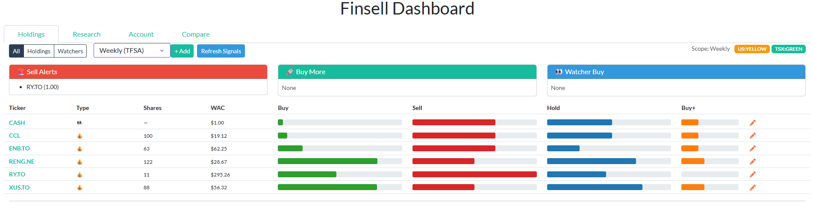
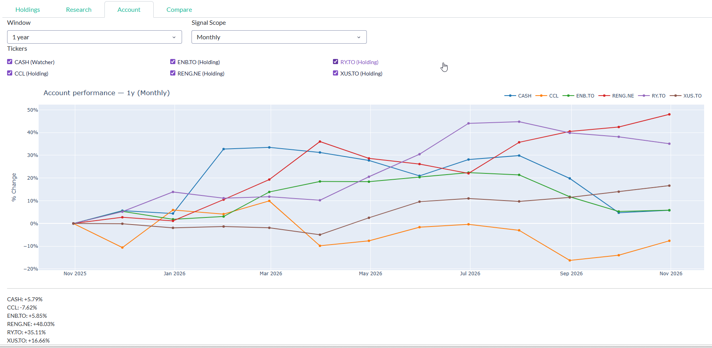
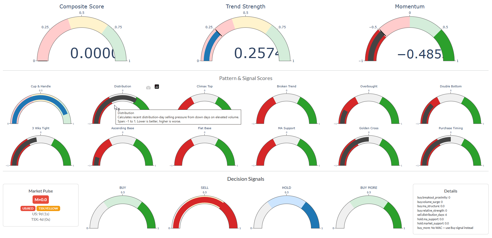

# FinSell

A Python-based financial tool for numerical analysis, pattern detection, and signal generation for stock and crypto assets.

This was created as a personal project to help me understand analyzing and interpreting financial markets based on signal trading techniques and quantitative analysis, from a couple books I have read.

I am sharing this project publicly to document my learning process and to potentially help others who are interested in similar financial analysis techniques.  I really don't understand signals yet and certainly don't use this tool for actual trading decisions. I do, however, make my own decisions and then compare them with the signals generated by this tool after the fact.

It works for me, and makes sense to my brain. No guarantees that it is correct or suitable for your use.
If you use this tool, you do so at your own risk.

If you do find a bug or have suggestions for improvement, please feel free to open an issue or submit a pull request on the GitHub repository.

## Overview

`finsell` provides a suite of utilities to fetch financial data, calculate technical indicators, and generate trading signals based on various patterns (e.g., RSI, MACD, Bollinger Bands). It also features a multi-mode dashboard for visual analysis.

## Key Features

- **Data Fetching**: Integrated with `yfinance` to retrieve OHLCV data for stocks, ETFs, and cryptocurrencies.
- **Signal Generation**: Implements various technical analysis signals:
    - RSI Crossover
    - MACD Crossover
    - Bollinger Band touches
    - Trailing stop signals
- **Pattern Detection**: Provides scoring and identification of market patterns (e.g., cup handles, distribution days).
- **Interactive Dashboard**: A Dash/Plotly-based visual interface with multiple modes:
    - **Holdings**: Overview of your portfolio.
    - **Research**: Deep dive into specific tickers.
    - **Account**: High-level performance metrics.
    - **Compare**: Side-by-side analysis of multiple assets.

## Interactive Dashboard Screenshots







## Installation
 Install the dependencies using `pip` (or use the `install.bat` script if available in your environment):

```bash
pip install -e .
```

## Usage

### CLI Tools

The project provides several entry points for analysis and dashboarding.

**Run the Dashboard:**
```bash
python -m finsell.dashboard_v2 --portfolio=".\data\sample\portfolio.json" --port 8050
```
**Once the server is running, open your web browser and navigate to http://127.0.0.1:8050/**

*There is a sample in dashboard-sample.bat for running the dashboard with the sample portfolio.*

### Data Source
The tool uses `yfinance` as the primary data source. It also supports loading data from local CSV files.

## Portfolio Configuration

Portfolios are stored in JSON format. 

- **Sample Portfolio**: A sample portfolio is provided for testing purposes in `data/sample/portfolio.json`.
- **Personal Portfolios**: Your personal portfolio files (e.g., in `data/watchlist/`, `data/jim/`, etc.) are **not** included in the Git repository for privacy.

## Project Structure

- `finsell/`: Core logic for data fetching, signal generation, and dashboard rendering.
- `data/`: Contains portfolio JSON files and cached market data.
- `tests/`: Unit and integration tests.
- `examples/`: Sample scripts for quickstart.

## Development

To run tests:
```bash
pytest
```

To format code:
```bash
ruff format .
```